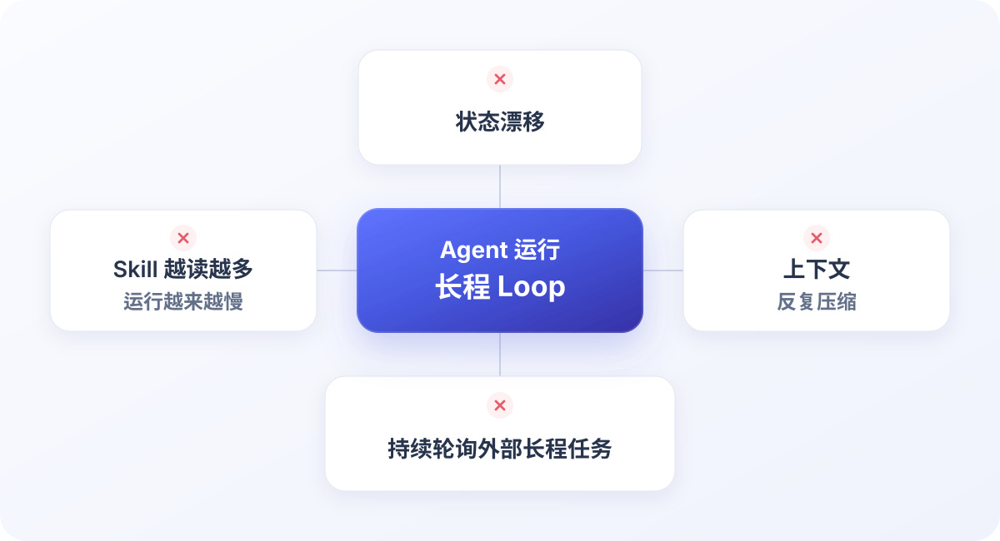
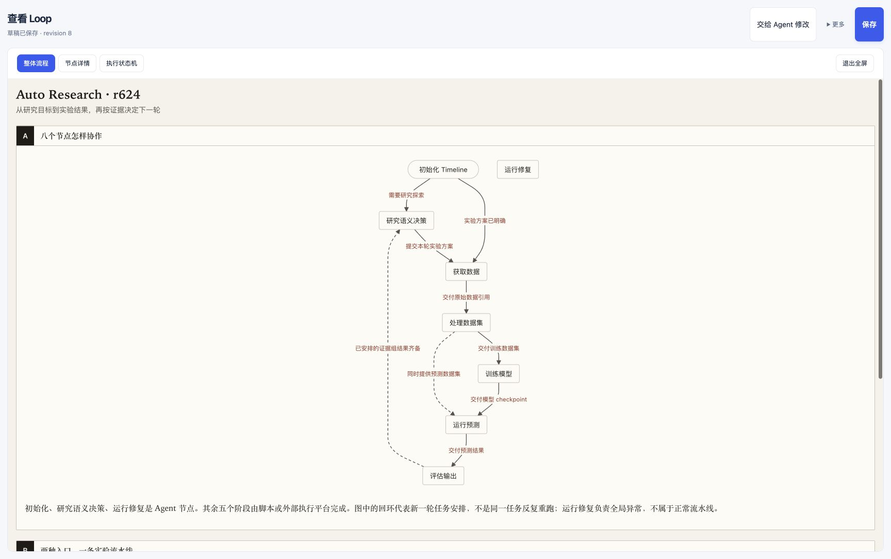

# Loop Anything

**把已有 Skill 变成能持续运行的 Loop。**



把目标和 Skill 交给你的 Agent：确定的动作交给脚本和状态机，需要临场判断的地方交给流程 Agent，长时间执行和等待由平台接手。先跑起来，保留过程与结果，再逐步固化稳定规则。

## 看见整个流程

网页供你理解流程、查看节点和结果，以及启动、暂停、恢复和轻量修改；复杂构建交给 Agent。



*当前本地平台的 r624 整体流程页实拍：展示八个节点及业务关系，不代表已启动真实训练。*

## 安装平台

把本 README 交给你的 Agent，按[安装与升级说明](docs/installation.md)完成平台安装和 Skill 配置。需要 Python 3.9+；已有平台和工作区应继续复用。

在源码或安装包目录执行：

```sh
python3 install.py
```

macOS 默认安装后台服务；Windows/Linux 当前使用前台启动。安装器返回实际平台 Python、启动入口和工作区信息。日常构建、运行、通信和通知直接使用[平台 Skill](skills/loop-anything-platform/SKILL.md)。

## 本地预览

在源码目录运行：

```sh
python3 -m loop_anything serve --demo --open
```

默认地址为 http://127.0.0.1:8767。示例只展示模拟流程，不执行真实训练或预订；前台预览需要保持进程运行。

## 按需查阅

- [平台 Skill](skills/loop-anything-platform/SKILL.md)：Agent 构建、运行和协作的统一入口。
- [网页使用说明](docs/user-guide.md)：查看详情、结果与运行操作。
- [开发说明](docs/development.md)：源码结构、测试和构建发布。
