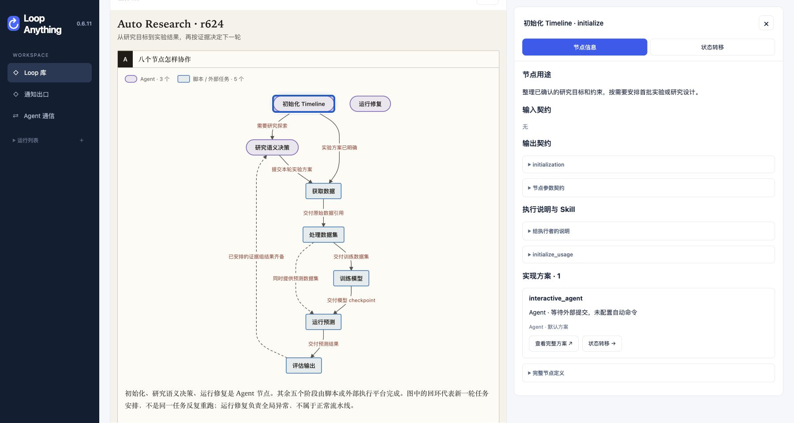
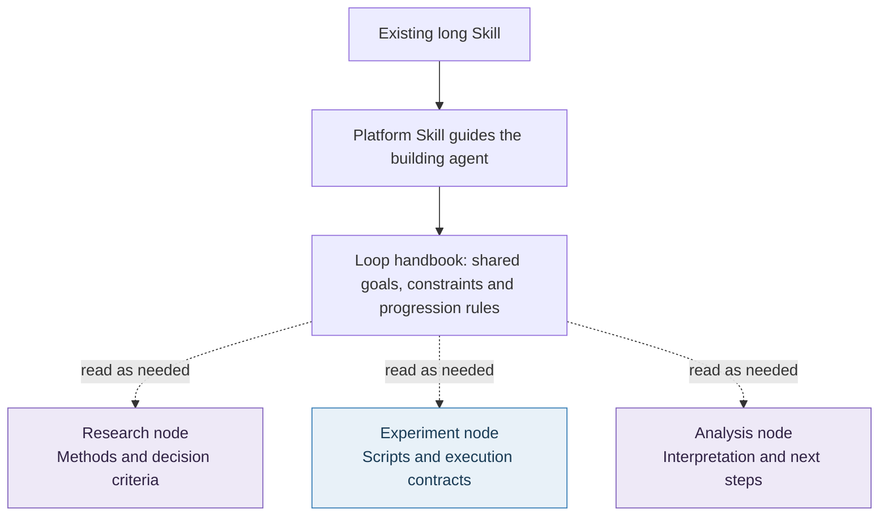
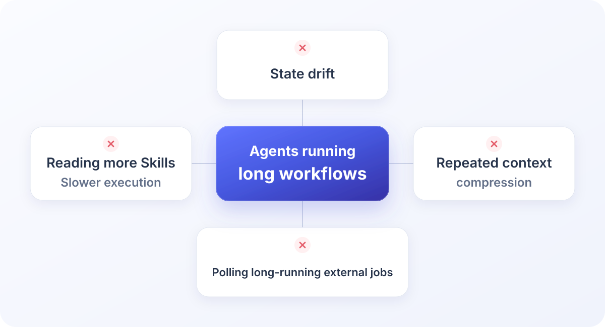

# Loop Anything

**English** | [简体中文](README.zh-CN.md)

**Turn a long Skill into a workflow you can see, understand, and change.**

Research, training, analysis: an agent can handle each step. As the steps and iterations multiply, the whole process becomes harder to follow. Progress gets buried in conversations, one change affects pages of instructions, and the agent keeps rereading context and checking external jobs.

Loop Anything brings that process together through **visual workflows** and **Skills split by responsibility**. Bring your goal and an existing Skill; the platform Skill guides your agent through turning them into a Loop.

## See the whole workflow—and every step

See where agents make decisions, where scripts execute work, and how results reach the next step. During a run, progress, results, waiting, and failures have a place you can inspect.

*An actual Auto Research workflow view, shown with Chinese labels: eight nodes and two execution types. Select a node to inspect its purpose, implementation, and state transitions.*

To change the workflow, point your agent to a node: **“Try a different approach here. Keep the rest.”**

## Split a long Skill into parts you can work on

The platform Skill guides the building agent to separate responsibilities. Shared goals, constraints, and progression rules stay in the Loop handbook. Each node keeps its own methods, input/output contracts, and execution implementation.

An example of how the instructions are organized:

**Understand, change, and verify each part on its own.** To change data preparation, focus on that node. Preserve its input/output contract and reuse the rest. Agents read the instructions relevant to their current task, reducing unrelated context, repeated instructions, and the risk of drift during long tasks.

Start with room for judgment: scripts and state machines handle known actions; a flow agent handles decisions that depend on the situation. After a few runs, you and your agent can turn stable paths into explicit rules.

## Less busywork during long tasks

While training waits in a queue, the agent can finish its current work. The platform takes over with script checks or event waits, then advances the workflow when the condition is met. Progress and results remain available for subsequent tasks, reducing the time and tokens spent polling, rereading instructions, and rebuilding context.

Work can also run on agents or scripts on other machines. When a task needs outside help, the collaboration result returns to the original workflow.

## Start with the Skill you already have

Give your agent this README, your Skill, and your goal:

> Turn this Skill into a Loop. Split nodes by responsibility, draw the workflow and its relationships, and let the platform handle long waits. Keep decisions flexible where judgment is still needed; improve the workflow after it runs.

- [Install and get started](docs/installation.md) (Chinese): let your agent set up the platform and Skills, or try a local preview.
- [User guide](docs/user-guide.md) (Chinese): inspect progress and results, and control runs.
- [Platform Skill](skills/loop-anything-platform/SKILL.md): construction and runtime guidance for your agent.
- [Lightweight dispatch Skill](skills/loop-anything-dispatch/SKILL.md): send work to other agents without running the full platform.
- [Developer guide](docs/development.md) (Chinese): development, tests, and distribution builds.

## For the installation agent

Loop Anything has two roles, which can share one machine:

- **Server**: stores Loops and Runs, advances workflows, and provides the web interface.
- **Client**: views, edits, and runs Loops through the server; also supports local task execution, receiving work, and personal scheduled or conditional jobs.

**Before installing, ask the user which role this machine needs: server, client, or both.** Follow an existing explicit choice without asking again. Then use the [installation guide](docs/installation.md) to set up the chosen role and Skills. Receiving work and running local jobs require an explicit start; installation alone does not start them.
