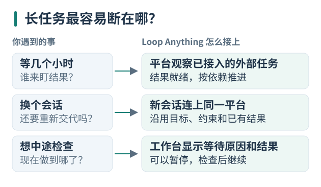
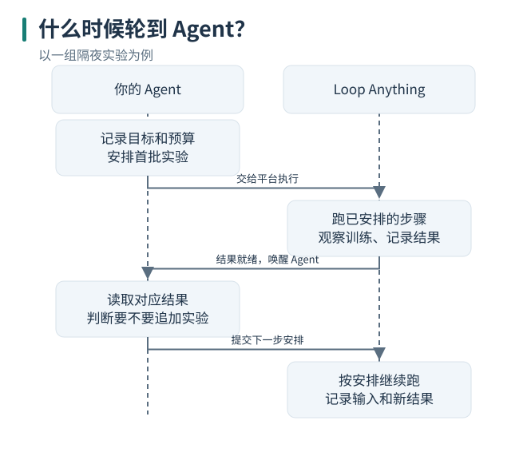

# Loop Anything

**让 Agent 的长任务跨会话接着跑。**

今晚交给 Agent 一组实验，训练要跑几个小时。明早回来，你想直接知道：哪组跑完了？还在等什么？下一轮值得做什么？

Loop Anything 是给长程 Agent 任务用的工作台。平台保存进度、推进已安排的步骤，你已有的 Agent 在需要判断时接手。

[先看本地演示](#先看一个例子) · [接入你的 Agent](#安装平台)



## 一场隔夜实验，谁来做什么？



把任务交给平台后，当前会话可以结束。只要平台保持运行，它就会继续观察已接入的任务，并在配置的决策点唤醒 Agent。

到了需要你确认的步骤，可以配置通知并等你放行。暂停会暂缓派发新步骤，已提交的训练仍由外部系统运行。

## 先看一个例子

获取本仓库源码，在项目目录运行（Python 3.9+）：

```sh
python3 -m loop_anything --db ./.loop-anything/preview/preview.db serve --demo --port 8877
```

打开 [本地演示](http://127.0.0.1:8877/#loop_definitions)，沿着 **Loop 库 → Auto Research · 平台版 → 异步训练** 查看：数据从哪里来，训练结果怎样交给后续任务。

演示使用独立的预览数据库和模拟实现，无需配置模型或训练服务。预览期间保持终端运行。

## 安装平台

按[安装指南](docs/installation.md)启动平台，把平台 Skill 加载到你常用的 Agent。挑一件经常需要等结果的工作，把它整理成可重复运行的流程，这就是 **Loop**。

把任务说明和已有脚本发给 Agent，可以这样说：

> 用 Loop Anything 把这件事做成一个 Loop。让已有脚本跑批处理，等结果就绪后由你检查并给出下一步建议。下一批执行前等我确认。先给我一份可预览的草稿。

[查看工作台使用说明](docs/user-guide.md) · [查看 Agent 接入说明](docs/agent-integration.md)
