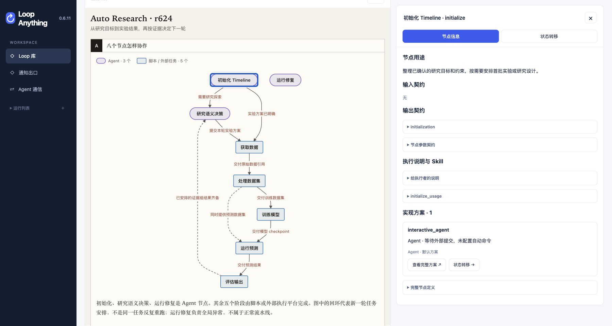
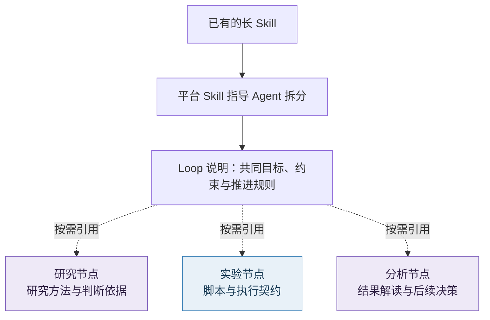
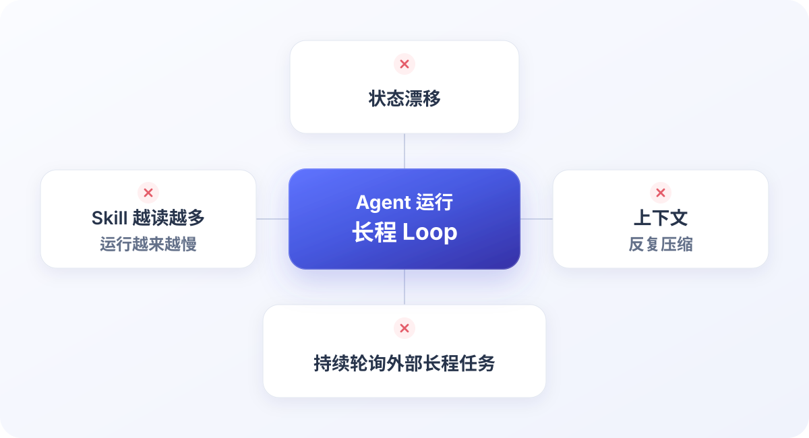

# Loop Anything

[English](README.md) | **简体中文**

**把长 Skill 变成看得懂、拆得开、改得动的工作流。**

研究、训练、分析，单步都能交给 Agent。步骤一多、轮次一长，整套过程却越来越难掌握：进展藏在对话里，修改牵动整篇说明，Agent 反复读上下文、查外部任务。

Loop Anything 用**可视化流程**和**按职责拆分的 Skill**，把这套过程组织起来。你提供目标和已有 Skill，平台 Skill 指导你的 Agent 完成拆分与构建。

## 看清整个流程，也看清每一步

哪些环节由 Agent 判断，哪些交给脚本执行，结果怎样流向下一步，都能在图中看见。运行时，进度、结果、等待和异常有明确的位置。

*Auto Research 的流程定义实拍：八个节点、两类执行方式，点击节点查看用途、实现与状态转移。*

想调整流程时，可以直接指着某个节点与 Agent 讨论：**“这一段换个方法，其他部分继续沿用。”**

## 把长 Skill 拆开，让每一段都容易修改

平台 Skill 会引导构建 Agent 理清职责：共同目标、约束和推进规则留在 Loop 说明里，各节点保留自己的方法、输入输出和执行方式。

说明如何按职责组织，示意如下：

**每一段都可以单独理解、修改和验证。** 调整数据处理方法，可以集中修改对应节点；保持输入输出契约后，其他环节继续复用。Agent 按当前任务读取说明，减少无关上下文和重复指令，也降低长程执行中的漂移风险。

初版可以保留灵活性：确定的动作交给脚本和状态机，需要临场判断的地方交给流程 Agent。运行几轮后，你和 Agent 再把稳定路径固化成规则，让流程逐步成熟。

## 长程任务，少一些空转

训练还在排队，Agent 可以先结束本次工作。平台通过脚本检查或事件等待接管后续，条件满足后再推进任务。进度与结果持续保留，后续工作有据可查，减少反复轮询、重读说明和重建上下文带来的时间与 token 开销。

任务也可以交给其他机器上的 Agent 或脚本执行；需要外援时，协作结果会回到原来的工作中。

## 从你已有的 Skill 开始

把本 README、你的 Skill 和目标交给 Agent：

> 帮我把这份 Skill 变成 Loop。按职责拆分节点，画清流程和节点关系，把长时间等待交给平台。先保留需要临场判断的部分，跑起来后再逐步优化。

- [安装与开始使用](docs/installation.md)：让 Agent 完成平台与 Skill 配置，也可先本地预览。
- [使用手册](docs/user-guide.md)：查看进度、结果和运行操作。
- [平台 Skill](skills/loop-anything-platform/SKILL.md)：给 Agent 的构建与运行指南。
- [轻量派单 Skill](skills/loop-anything-dispatch/SKILL.md)：只给其他 Agent 派任务，无需运行完整平台。
- [开发说明](docs/development.md)：参与开发、测试和构建。

## 给安装 Agent

Loop Anything 分为两个角色，可以在同一台机器上兼任：

- **服务端**：保存 Loop 和 Run，推进流程，提供网页。
- **客户端**：通过服务端查看、编辑和运行 Loop，也支持本机执行、接单，以及个人定时或条件触发任务。

**安装前，请先询问用户：这台机器需要安装服务端、客户端，还是兼任两者？** 用户已经明确选择时直接沿用，不重复询问。随后按[安装说明](docs/installation.md)配置所选角色和 Skill。接单和本机任务需要明确启动，安装本身不会启动它们。
